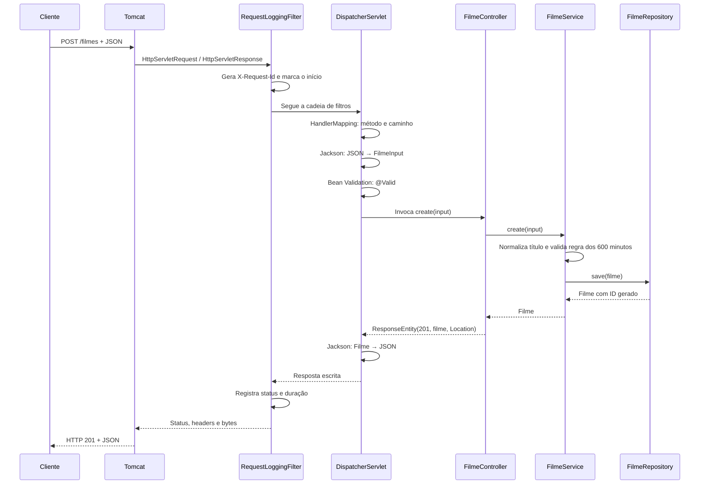

# 🎬 Catálogo de Filmes — API REST em Java com Spring Boot

API para gerenciar o catálogo de filmes de uma plataforma de streaming, desenvolvida em **Java 21** com **Maven** e **Spring Boot 3.x** (Tomcat embutido, container IoC do Spring, injeção de dependências por construtor, Spring MVC, Bean Validation e Jackson). Projeto acadêmico: sem frontend, banco de dados ou autenticação; os dados ficam em memória.

O projeto fica na pasta `catalogo-filmes/`. Os comandos abaixo devem ser executados de dentro dela.

## 👥 Integrantes

- Joao Henrique
- Maria Karolayne
- Mylena Meirellys
- Victor Gabriel
- Glaydson
- Lucas Emanoel

## 🎯 Domínio

**Tema:** catálogo de filmes. **Entidade principal:** `Filme`, um título disponível na plataforma. Recurso HTTP: `/filmes`.

| Campo | Tipo | Origem | Regra |
|---|---|---|---|
| `id` | `long` | Gerado automaticamente (sequência 1, 2, 3…) | Nunca vem do cliente; preservado na atualização |
| `titulo` | `String` | Entrada | Obrigatório; não aceita vazio nem só espaços; espaços nas pontas são removidos |
| `duracaoMinutos` | `int` | Entrada | Maior que zero e no máximo 600 |

O cliente envia apenas `titulo` e `duracaoMinutos` (DTO `FilmeInput`); enviar qualquer outro campo, como `id`, resulta em **400**.

### 📌 Regra de negócio

Um filme pode ter **no máximo 600 minutos** de duração.

Implementada no `FilmeService` e aplicada igualmente no cadastro e na atualização. Violações retornam **HTTP 422 (Unprocessable Entity)** com a mensagem `Um filme pode ter no máximo 600 minutos`. Exatamente 600 é aceito; 601 é rejeitado.

Separação entre os tipos de erro:

- **400:** forma da entrada inválida (título vazio ou em branco, duração ≤ 0, JSON malformado, tipo incorreto, campo desconhecido, ID não numérico). Verificado antes da execução do método do controller, pelo Bean Validation (`@Valid`, `@NotBlank`, `@Positive`) e pelo Jackson.
- **422:** entrada bem formada que viola a regra de domínio (duração > 600).

Toda validação ocorre antes de qualquer escrita no repositório, portanto uma operação rejeitada (400, 404 ou 422) não altera os dados armazenados.

## 🏗️ Arquitetura em camadas

```text
src/main/java/br/com/minispring/filmes/
├── Application.java          Ponto de entrada (@SpringBootApplication)
├── config/                   RequestLoggingFilter (X-Request-Id e duração)
├── controller/               FilmeController (HTTP), InfoController (/ e /health)
├── service/                  FilmeService (regra de negócio, 404, 422)
├── repository/               FilmeRepository (interface) e InMemoryFilmeRepository
├── model/                    Filme (entidade) e FilmeInput (DTO de entrada)
└── exception/                Exceções de domínio, ErroResposta e ApiExceptionHandler
src/main/resources/
└── application.properties
```

| Camada | Responsabilidade |
|---|---|
| Controller | Mapeia rotas e status HTTP (201 + `Location`, 204); não contém regra de negócio |
| Service | Aplica a regra dos 600 minutos, normaliza o título, filtra e traduz ausência em 404 |
| Repository | Armazena em memória (`ConcurrentHashMap`), gera IDs (`AtomicLong`); não conhece HTTP |
| Exception | Traduz exceções em respostas HTTP com corpo padronizado (`@RestControllerAdvice`) |

**Injeção de dependências por construtor:** `FilmeController` → `FilmeService` → `FilmeRepository` (interface; o Spring injeta a única implementação disponível, `InMemoryFilmeRepository`, anotada com `@Repository`).

O component scan do `@SpringBootApplication` varre o pacote `br.com.minispring.filmes` e seus subpacotes; por isso `Application` deve ficar na raiz desse pacote.

## ▶️ Como executar

**Pré-requisitos:** JDK 21 e Maven 3.9+ (internet na primeira compilação, para baixar dependências).

```sh
cd catalogo-filmes
mvn clean verify                              # compila, roda os testes e gera o JAR
java -jar target/catalogo-filmes-1.0.0.jar    # inicia a API
```

O JAR é um *fat JAR* executável gerado pelo `spring-boot-maven-plugin` (goal `repackage`, executado na fase `package`). Durante o desenvolvimento, também é possível iniciar sem gerar o JAR:

```sh
mvn spring-boot:run
```

A API sobe em **http://127.0.0.1:8080**. Teste com `curl -i http://127.0.0.1:8080/health` (esperado: `200` e `{"status":"UP"}`).

**Pela IDE:** importe a pasta `catalogo-filmes` como projeto Maven (JDK 21) e execute `br.com.minispring.filmes.Application`.

**Outra porta:**

```sh
java -Dserver.port=9090 -jar target/catalogo-filmes-1.0.0.jar
java -jar target/catalogo-filmes-1.0.0.jar --server.port=9090
SERVER_PORT=9090 java -jar target/catalogo-filmes-1.0.0.jar
```

Precedência da configuração (maior para menor): argumentos de linha de comando > propriedades da JVM (`-D`) > variáveis de ambiente > `application.properties`. O Spring Boot aplica *relaxed binding*: `server.port` corresponde a `SERVER_PORT`.

Os dados são perdidos ao reiniciar.

**Somente testes:** `mvn test` (cada classe de teste de integração sobe o servidor embutido em porta aleatória).

### Configuração (`application.properties`)

```properties
spring.application.name=catalogo-filmes
server.port=8080
server.address=127.0.0.1

# Campos desconhecidos no JSON resultam em 400 (o padrão do Spring Boot é ignorá-los)
spring.jackson.deserialization.fail-on-unknown-properties=true
```

### Dependências principais (`pom.xml`)

```xml
<parent>
  <groupId>org.springframework.boot</groupId>
  <artifactId>spring-boot-starter-parent</artifactId>
  <version><!-- versão 3.x corrente --></version>
</parent>

<properties>
  <java.version>21</java.version>
</properties>

<dependencies>
  <dependency>
    <groupId>org.springframework.boot</groupId>
    <artifactId>spring-boot-starter-web</artifactId>
  </dependency>
  <dependency>
    <groupId>org.springframework.boot</groupId>
    <artifactId>spring-boot-starter-validation</artifactId>
  </dependency>
  <dependency>
    <groupId>org.springframework.boot</groupId>
    <artifactId>spring-boot-starter-test</artifactId>
    <scope>test</scope>
  </dependency>
</dependencies>

<build>
  <plugins>
    <plugin>
      <groupId>org.springframework.boot</groupId>
      <artifactId>spring-boot-maven-plugin</artifactId>
    </plugin>
  </plugins>
</build>
```

### Problemas comuns

| Problema | Como resolver |
|---|---|
| `mvn` não encontrado | Instale o Maven e confira o `PATH`. |
| Java incompatível | Confira `java -version`, `mvn -version` e o `JAVA_HOME`; use JDK 21. |
| Porta 8080 ocupada | Encerre a execução anterior ou use `--server.port=9090`. |
| JAR não encontrado | Execute `mvn clean verify` dentro da pasta `catalogo-filmes/`. |
| `no main manifest attribute` | Confirme o `spring-boot-maven-plugin` no `pom.xml` e gere o JAR novamente. |
| Campo desconhecido não gera 400 | Confira `spring.jackson.deserialization.fail-on-unknown-properties=true`. |
| Validação não é executada | Confirme `spring-boot-starter-validation` no `pom.xml` e `@Valid` no parâmetro `@RequestBody`. |

## 🔗 Rotas

| Método | Rota | Descrição | Sucesso | Erros |
|---|---|---|---|---|
| POST | `/filmes` | Cadastra filme | 201 + `Location: /filmes/{id}` + JSON | 400, 415, 422 |
| GET | `/filmes` | Lista todos | 200 | |
| GET | `/filmes?titulo=texto` | Filtra por parte do título, sem diferenciar maiúsculas/minúsculas | 200 | |
| GET | `/filmes/{id}` | Consulta por ID | 200 | 400 (ID inválido), 404 |
| PUT | `/filmes/{id}` | Atualiza (ID preservado) | 200 | 400, 404, 415, 422 |
| DELETE | `/filmes/{id}` | Exclui | 204 (sem corpo) | 400, 404 |
| GET | `/` e `/health` | Identificação e saúde | 200 | |

**Corpo de entrada (POST e PUT):**

```json
{ "titulo": "Matrix", "duracaoMinutos": 136 }
```

**Resposta:**

```json
{ "id": 1, "titulo": "Matrix", "duracaoMinutos": 136 }
```

**Erro (exemplo de 422):**

```json
{
  "timestamp": "2026-10-20T12:00:00Z",
  "status": 422,
  "message": "Um filme pode ter no máximo 600 minutos",
  "path": "/filmes",
  "details": [],
  "requestId": "..."
}
```

### Resumo dos status

| Status | Quando |
|---|---|
| 201 | Filme criado (com cabeçalho `Location`) |
| 200 | Consultas e atualização |
| 204 | Exclusão |
| 400 | Entrada inválida (título em branco, duração ≤ 0, JSON inválido, campo desconhecido, ID não numérico) |
| 404 | Filme ou rota inexistente |
| 405 | Método não permitido (inclui `Allow`) |
| 415 | `Content-Type` diferente de JSON em `@RequestBody` |
| 422 | Duração acima de 600 minutos |
| 500 | Falha inesperada; detalhes técnicos ficam no log |

### Exemplos rápidos

```sh
curl -i -X POST http://127.0.0.1:8080/filmes -H 'Content-Type: application/json' \
  -d '{"titulo":"Matrix","duracaoMinutos":136}'               # 201 + Location
curl -i 'http://127.0.0.1:8080/filmes?titulo=MATRIX'          # 200, filtro case-insensitive
curl -i -X PUT http://127.0.0.1:8080/filmes/1 -H 'Content-Type: application/json' \
  -d '{"titulo":"Matrix Reloaded","duracaoMinutos":138}'      # 200
curl -i -X POST http://127.0.0.1:8080/filmes -H 'Content-Type: application/json' \
  -d '{"titulo":" ","duracaoMinutos":0}'                      # 400
curl -i -X POST http://127.0.0.1:8080/filmes -H 'Content-Type: application/json' \
  -d '{"titulo":"Longo","duracaoMinutos":601}'                # 422
curl -i -X DELETE http://127.0.0.1:8080/filmes/1              # 204
```

Mais exemplos de sucesso e erro em [requests.http](requests.http).

## 🧪 Testes

`ApiIntegrationTest` usa `@SpringBootTest(webEnvironment = WebEnvironment.RANDOM_PORT)`, que sobe a aplicação completa com Tomcat embutido em porta livre, e cobre: CRUD completo, `Location`, ID gerado e preservado, filtro sem diferenciar maiúsculas, limite de 600 (aceita 600, rejeita 601), validações idênticas em POST e PUT, dados intactos após operações rejeitadas, 404, 405, 415 e concorrência na geração de IDs.

## 🌱 Recursos do Spring Boot utilizados

| Recurso | Implementação | Comportamento |
|---|---|---|
| Autoconfiguração | `@SpringBootApplication` | Configura servidor, Spring MVC, Jackson e validação a partir do classpath |
| Component scan | `@RestController`, `@Service`, `@Repository` | Descoberta de beans por anotações em tempo de execução |
| Inversão de controle | `ApplicationContext` | O Spring decide quando e como construir os objetos |
| Injeção por construtor | `FilmeController` → `FilmeService` → `FilmeRepository` | Dependências explícitas, imutáveis e substituíveis |
| Resolução por interface | `FilmeRepository` / `InMemoryFilmeRepository` | A abstração é ligada à implementação na inicialização |
| Escopo singleton | Escopo padrão dos beans | Uma instância por container, compartilhada entre requisições |
| Fail fast | `ApplicationContext` | Ciclos, ambiguidades e dependências ausentes impedem a aplicação de iniciar |
| Servidor e Servlet | Tomcat embutido (`spring-boot-starter-web`) | Transporte HTTP incluído no JAR executável |
| Front Controller | `DispatcherServlet` | Um ponto central coordena todas as requisições |
| Roteamento | `@RequestMapping`, `@GetMapping`, `@PostMapping`, `@PutMapping`, `@DeleteMapping` | Método HTTP + caminho selecionam um método Java |
| Binding | `@PathVariable`, `@RequestParam`, `@RequestBody` | Texto da rede é convertido em argumentos tipados |
| Serialização e DTO | Jackson e `FilmeInput` | JSON de entrada não precisa ter a estrutura da entidade |
| Validação | Bean Validation: `@Valid`, `@NotBlank`, `@Positive` | Validação estrutural antes de executar regras de negócio |
| Erros HTTP | `@RestControllerAdvice` (`ApiExceptionHandler`) | Tratamento centralizado; status, headers e corpo têm funções distintas |
| Respostas | `ResponseEntity` | Status, headers (`Location`) e corpo definidos explicitamente |
| Comportamento transversal | `RequestLoggingFilter` (`OncePerRequestFilter`) | `X-Request-Id` e log de duração sem repetição nos controllers |
| Observabilidade | `X-Request-Id`, logs de duração | Relacionar resposta, erro e linha de log |
| Concorrência | `ConcurrentHashMap`, `AtomicLong` | Requisições diferentes usam os mesmos beans |
| Testes | `src/test/java`, `spring-boot-starter-test` | Testes de unidade e de integração com servidor embutido |

O tratamento de erros estende `ResponseEntityExceptionHandler`, que já converte as exceções do Spring MVC (corpo ilegível, argumento inválido, tipo incompatível, método não permitido, `Content-Type` não suportado, rota inexistente) nos status corretos, preservando o cabeçalho `Allow` do 405. O `ApiExceptionHandler` substitui apenas o corpo, para seguir o formato padronizado, e acrescenta o tratamento das exceções de domínio (404 e 422) e de falhas inesperadas (500). O filtro (e não um `HandlerInterceptor`) gera o `X-Request-Id`, porque filtros executam também nas requisições que falham antes de chegar a um controller, como 404 e 405.

### Do Mini Spring ao Spring Boot

O projeto foi inicialmente construído sobre o framework Mini Spring, fornecido como base. Correspondência entre as peças:

| Mini Spring | Spring Boot |
|---|---|
| `framework/annotation` | `org.springframework.stereotype` e `org.springframework.web.bind.annotation` |
| `ComponentScanner` | Component scan do `@SpringBootApplication` |
| `ApplicationContext` próprio | `ApplicationContext` do Spring |
| `MiniApplication` | `SpringApplication.run(...)` |
| Jetty + `DispatcherServlet` próprio | Tomcat + `DispatcherServlet` do Spring MVC |
| `Router` e `@Route` | `HandlerMapping` e `@RequestMapping` e variações |
| `Validator`, `@NotBlank`, `@Positive` | Bean Validation (`jakarta.validation`) com `@Valid` |
| `HttpException` e `HttpResult` | Exceções de domínio, `@RestControllerAdvice` e `ResponseEntity` |
| `LoggingInterceptor` | `RequestLoggingFilter` |

## 🔄 Caminho de uma requisição



Se a validação, o binding ou a regra de negócio falharem, a exceção é capturada pelo `ApiExceptionHandler`, que devolve o status e o corpo de erro padronizado no lugar do passo 201.

## 📋 Contrato de erros

| Status | Situação |
|---|---|
| 400 | JSON inválido, campo desconhecido, DTO inválido ou ID não numérico |
| 404 | Rota ou filme inexistente |
| 405 | Caminho existente com método não suportado; inclui `Allow` |
| 415 | `@RequestBody` sem `Content-Type: application/json` |
| 422 | Regra de negócio: duração acima de 600 minutos |
| 500 | Falha inesperada; detalhes técnicos ficam no log |

Erros tratados pelo `ApiExceptionHandler` têm `timestamp`, `status`, `message`, `path`, `details` e `requestId`. Em erros de validação, `details` lista os campos inválidos. Erros rejeitados pelo próprio Tomcat antes do `DispatcherServlet` (por exemplo, uma requisição HTTP malformada) podem ter outro formato. A validação automática se aplica aos parâmetros anotados com `@Valid`; uma chamada direta ao service não passa pelo pipeline HTTP.

## 🤖 Uso de IA (ChatGPT)

A Inteligência Artificial foi utilizada como ferramenta de apoio durante o desenvolvimento do projeto, auxiliando na criação e adaptação de classes, testes e documentação.

O código foi revisado pelos integrantes do grupo, que são responsáveis por compreender e explicar o funcionamento do projeto.

## 📚 Documentação

Consulte o [guia de arquitetura](docs/ARQUITETURA.md) para conhecer a organização dos componentes, as decisões de implementação e os pontos de extensão. O documento de [conceitos e referências](docs/CONCEITOS-E-REFERENCIAS.md) reúne explicações e links para aprofundamento.

Referências oficiais:

- [Spring Boot Reference](https://docs.spring.io/spring-boot/reference/)
- [Spring MVC](https://docs.spring.io/spring-framework/reference/web/webmvc.html)
- [Bean Validation com Spring](https://docs.spring.io/spring-framework/reference/core/validation/beanvalidation.html)

## ⚠️ Escopo e limitações

O armazenamento da aplicação é em memória. O projeto não inclui banco de dados, JPA, transações, autenticação nem autorização. Esses itens são extensões naturais com `spring-boot-starter-data-jpa`, `@Transactional` e `spring-boot-starter-security`.

O endpoint `/health` confirma que a aplicação responde; não verifica dependências externas. O servidor escuta em `127.0.0.1` por padrão.
