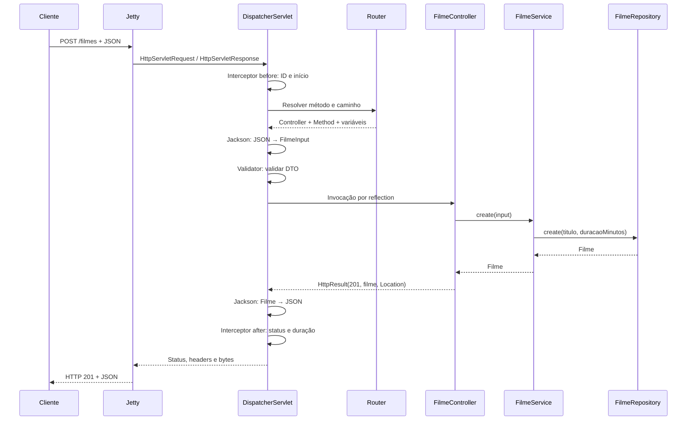

# Catálogo de Filmes — API REST em Java

API para gerenciar o **catálogo de filmes de uma plataforma de streaming**, construída sobre o framework **Mini Spring** (Java 21, Jetty embutido, container IoC próprio, injeção por construtor e roteamento por anotações). Projeto acadêmico: sem frontend, banco de dados ou autenticação; os dados ficam em memória.

## Integrantes

| Nome | Matrícula |
|---|---|
| _Preencher: nome do integrante 1_ | _—_ |
| _Preencher: nome do integrante 2_ | _—_ |
| _Preencher: nome do integrante 3_ | _—_ |

## Domínio

**Tema:** Catálogo de filmes. **Entidade principal:** `Filme`, um título disponível na plataforma.

| Campo | Tipo | Origem | Regra |
|---|---|---|---|
| `id` | `long` | Gerado automaticamente (sequência 1, 2, 3…) | Nunca vem do cliente; preservado na atualização |
| `titulo` | `String` | Entrada | Obrigatório; não aceita vazio nem só espaços; espaços nas pontas são removidos |
| `duracaoMinutos` | `int` | Entrada | Maior que zero e no máximo **600** |

O cliente envia apenas `titulo` e `duracaoMinutos` (DTO `FilmeInput`); enviar qualquer outro campo, como `id`, resulta em 400.

## Regra de negócio

> **Um filme pode ter no máximo 600 minutos de duração.**

Implementada no `FilmeService` e aplicada igualmente no cadastro e na atualização. Violações retornam **422** com a mensagem `Um filme pode ter no máximo 600 minutos`. Exatamente 600 é aceito; 601 é rejeitado.

Separação entre os tipos de erro:

- **400**: forma da entrada inválida (título vazio ou em branco, duração ≤ 0, JSON malformado, tipo incorreto, campo desconhecido, ID não numérico). Verificado antes do controller por `@NotBlank` e `@Positive`.
- **422**: entrada bem formada que viola a regra de domínio (duração > 600).

Toda validação ocorre **antes** de qualquer escrita no repositório, portanto uma operação rejeitada (400, 404 ou 422) **não altera** os dados armazenados.

## Arquitetura em camadas

```text
src/main/java/br/com/minispring/
├── framework/                  Framework fornecido (preservado)
└── filmes/
    ├── Application.java        Ponto de entrada
    ├── controller/             FilmeController (HTTP), InfoController (/ e /health)
    ├── service/                FilmeService (regra de negócio, 404, 422)
    ├── repository/             FilmeRepository (interface) e InMemoryFilmeRepository
    └── model/                  Filme (entidade) e FilmeInput (DTO de entrada)
```

| Camada | Responsabilidade |
|---|---|
| Controller | Mapeia rotas e status HTTP (`201` + `Location`, `204`); não contém regra de negócio |
| Service | Aplica a regra dos 600 minutos, normaliza o título, filtra e traduz ausência em 404 |
| Repository | Armazena em memória (`ConcurrentHashMap`), gera IDs (`AtomicLong`); não conhece HTTP |

Injeção de dependências por construtor: `FilmeController` → `FilmeService` → `FilmeRepository` (interface; o container escolhe `InMemoryFilmeRepository`).

## Como executar

Pré-requisitos: **JDK 21** e **Maven 3.9+** (internet na primeira compilação, para baixar dependências).

```sh
mvn clean verify                              # compila, roda os testes e gera o JAR
java -jar target/catalogo-filmes-1.0.0.jar    # inicia a API
```

A API sobe em **http://127.0.0.1:8080**. Teste com `curl -i http://127.0.0.1:8080/health` (esperado: `200` e `{"status":"UP"}`).

Pela IDE: importe como projeto Maven (JDK 21) e execute `br.com.minispring.filmes.Application`.

Outra porta: `java -Dserver.port=9090 -jar target/catalogo-filmes-1.0.0.jar`. Os dados são perdidos ao reiniciar.

Somente testes: `mvn test` (cada teste sobe seu próprio Jetty em porta livre).

## Rotas

| Método | Rota | Descrição | Sucesso | Erros |
|---|---|---|---|---|
| POST | `/filmes` | Cadastra filme | **201** + `Location: /filmes/{id}` + JSON | 400, 415, 422 |
| GET | `/filmes` | Lista todos | **200** | |
| GET | `/filmes?titulo=texto` | Filtra por parte do título, sem diferenciar maiúsculas/minúsculas | **200** | |
| GET | `/filmes/{id}` | Consulta por ID | **200** | 400 (ID inválido), 404 |
| PUT | `/filmes/{id}` | Atualiza (ID preservado) | **200** | 400, 404, 415, 422 |
| DELETE | `/filmes/{id}` | Exclui | **204** (sem corpo) | 400, 404 |
| GET | `/` e `/health` | Identificação e saúde | **200** | |

Corpo de entrada (POST e PUT):

```json
{ "titulo": "Matrix", "duracaoMinutos": 136 }
```

Resposta:

```json
{ "id": 1, "titulo": "Matrix", "duracaoMinutos": 136 }
```

Erro (exemplo de 422):

```json
{
  "timestamp": "2026-10-20T12:00:00Z",
  "status": 422,
  "message": "Um filme pode ter no máximo 600 minutos",
  "path": "/filmes",
  "details": [],
  "requestId": "..."
}
```

### Resumo dos status

| Status | Quando |
|---|---|
| 201 | Filme criado (com cabeçalho `Location`) |
| 200 | Consultas e atualização |
| 204 | Exclusão |
| 400 | Entrada inválida (título em branco, duração ≤ 0, JSON inválido, ID não numérico) |
| 404 | Filme ou rota inexistente |
| 422 | Duração acima de 600 minutos |
| 405 / 415 / 413 | Método não permitido / Content-Type não JSON / corpo acima de 1 MiB (herdados do framework) |

## Exemplos rápidos

```sh
curl -i -X POST http://127.0.0.1:8080/filmes -H 'Content-Type: application/json' \
  -d '{"titulo":"Matrix","duracaoMinutos":136}'               # 201 + Location
curl -i 'http://127.0.0.1:8080/filmes?titulo=MATRIX'          # 200, filtro case-insensitive
curl -i -X PUT http://127.0.0.1:8080/filmes/1 -H 'Content-Type: application/json' \
  -d '{"titulo":"Matrix Reloaded","duracaoMinutos":138}'      # 200
curl -i -X POST http://127.0.0.1:8080/filmes -H 'Content-Type: application/json' \
  -d '{"titulo":" ","duracaoMinutos":0}'                      # 400
curl -i -X POST http://127.0.0.1:8080/filmes -H 'Content-Type: application/json' \
  -d '{"titulo":"Longo","duracaoMinutos":601}'                # 422
curl -i -X DELETE http://127.0.0.1:8080/filmes/1              # 204
```

Mais exemplos de sucesso e erro em [requests.http](requests.http).

## Testes

`ApiIntegrationTest` sobe um Jetty real e cobre: CRUD completo, `Location`, ID gerado e preservado, filtro sem diferenciar maiúsculas, limite de 600 (aceita 600, rejeita 601), validações idênticas em POST e PUT, dados intactos após operações rejeitadas, 404, 405, 415 e concorrência na geração de IDs.

## Recursos do framework (herdados do projeto base)

| Recurso | Implementação | Comportamento |
|---|---|---|
| Metadados e reflection | `framework/annotation`, `ComponentScanner` | Descoberta e interpretação de metadados em tempo de execução |
| Inversão de controle | `ApplicationContext` | O framework decide quando e como construir os objetos |
| Injeção por construtor | `FilmeController` → `FilmeService` → `FilmeRepository` | Dependências explícitas, imutáveis e substituíveis |
| Resolução por interface | `FilmeRepository` / `InMemoryFilmeRepository` | Uma abstração pode ser ligada a uma implementação na inicialização |
| Escopo singleton | `ApplicationContext.singletons` | Uma instância por container, compartilhada entre requisições |
| Fail fast | `ApplicationContext`, `Router` | Ciclos, ambiguidades, dependências ausentes e rotas duplicadas falham antes de abrir a porta |
| Bootstrap e ciclo de vida | `MiniApplication` | Ordenação da inicialização e encerramento do servidor |
| Servidor e Servlet | Jetty / `DispatcherServlet` | Separação entre transporte HTTP e despacho para código de aplicação |
| Front Controller | `DispatcherServlet.service` | Um ponto central coordena todas as requisições |
| Roteamento | `Router` e `@Route` | Método HTTP + caminho selecionam um método Java |
| Binding | `@PathVariable`, `@RequestParam`, `@RequestBody` | Texto da rede é convertido em argumentos tipados |
| Serialização e DTO | Jackson e `FilmeInput` | JSON de entrada não precisa ter a estrutura da entidade |
| Validação | `Validator`, `@NotBlank`, `@Positive` | Validação estrutural antes de executar regras de negócio |
| Erros HTTP | `HttpException`, `HttpResult` | Status, headers e corpo têm funções distintas |
| Interceptadores | `LoggingInterceptor` | Comportamento transversal sem repetição nos controllers |
| Observabilidade | `X-Request-Id`, logs de duração | Relacionar resposta, erro e linha de log |
| Concorrência | `ConcurrentHashMap`, `AtomicLong` | Requisições diferentes usam os mesmos beans |
| Testes | `src/test/java` | Testes de container, roteador e integração com Jetty real |

Os nomes lembram o Spring, mas estas anotações são independentes e não são compatíveis com ele. `@Route` reúne o papel dos mapeamentos HTTP. `HttpResult` permite definir explicitamente status, headers e corpo da resposta.

## Caminho de uma requisição



O Jetty interpreta HTTP e produz os objetos Servlet. O framework delega o transporte e a interpretação do protocolo HTTP ao Jetty. O despacho usa a API Servlet síncrona sobre Jetty 12, conforme o [guia oficial de aplicações Servlet do Jetty](https://jetty.org/docs/jetty/12/programming-guide/server/http.html).

## Organização

```text
src/main/java/br/com/minispring/
├── framework/
│   ├── annotation/       Metadados consumidos pelo framework
│   ├── context/          Configuração, descoberta e container IoC
│   ├── validation/       Validação de records
│   ├── web/              Rotas, binding, respostas e interceptadores
│   └── MiniApplication.java
└── filmes/
    ├── Application.java  Ponto de entrada
    ├── controller/       Contrato HTTP
    ├── service/          Regras de negócio
    ├── repository/       Interface e armazenamento em memória
    └── model/            Record de domínio e DTO de entrada
```

## Contrato de erros

| Status | Situação |
|---|---|
| 400 | JSON inválido, campo desconhecido, DTO inválido ou ID não numérico |
| 404 | Rota ou filme inexistente |
| 405 | Caminho existente com método não suportado; inclui `Allow` |
| 413 | Corpo de `@RequestBody` maior que 1 MiB |
| 415 | `@RequestBody` sem `Content-Type: application/json` |
| 422 | Regra de negócio: duração acima de 600 minutos |
| 500 | Falha inesperada; detalhes técnicos ficam no log |

Erros gerados pelo dispatcher têm `timestamp`, `status`, `message`, `path`, `details` e `requestId`. Erros rejeitados pelo próprio Jetty antes do Servlet podem ter outro formato. A validação automática se aplica aos parâmetros `@RequestBody`; uma chamada direta ao service não passa pelo pipeline HTTP.

## Documentação

Consulte o [guia de arquitetura](docs/ARQUITETURA.md) para conhecer a organização dos componentes, as decisões de implementação e os pontos de extensão. O documento de [conceitos e referências](docs/CONCEITOS-E-REFERENCIAS.md) reúne explicações e links para aprofundamento.

## Escopo e limitações

O armazenamento da aplicação é em memória. O projeto não inclui banco de dados, ORM, transações, autenticação, autorização, proxies AOP ou autoconfiguração condicional. As anotações são próprias e não oferecem compatibilidade com Spring.

O endpoint `/health` confirma que a aplicação responde; não verifica dependências externas. O servidor escuta em `127.0.0.1` por padrão.
